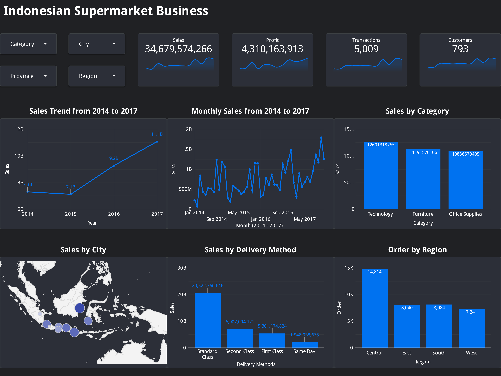

# Analyzing the Indonesian Supermarket Business

## Project Overview

This project analyzes Indonesian supermarket transaction data from 2014 to 2017 to identify sales trends, regional performance, product contributions, shipping preferences, and profit drivers. The project combines data analysis, interactive visualization, and predictive modeling to support business decision-making.

## Business Problem

The company lacks a clear view of sales performance across periods, regions, cities, product categories, and shipping methods. Data quality issues also limit the reliability of the analysis, while profit drivers remain unclear. Therefore, the company needs a cleaned dataset, an interactive dashboard, and predictive modeling to support accurate and data-driven decisions.

## Business Questions

- What was the trend in sales value from 2014 to 2017?
- What was the proportion of orders by region?
- What was the sales proportion for each product category?
- Which city generated the highest sales?
- Which shipping method was most frequently used by buyers?
- Which month saw the highest sales between 2014 and 2017?
- What is the estimated profit from the store's sales?

## Data Preparation

The dataset was cleaned in Google Sheets by:

- Removing duplicate records.
- Completing missing shipping dates.
- Completing missing postal codes.
- Standardizing missing and inconsistent city names.
- Storing cleaned values in new `clean_` columns.

## Tools

- **Google Sheets:** Data cleaning and analysis using `QUERY()`.
- **Looker Studio:** Interactive sales dashboard.
- **Orange Data Mining:** Profit prediction and model evaluation.
- **Google Slides:** Presentation of findings and recommendations.

## Project Workflow

```text
Raw Data → Data Cleaning → Data Analysis → Dashboard
                                ↓
                     Predictive Modeling
                                ↓
                  Insights and Recommendations
```

## Key Insights

- **Sales trend:** Sales increased overall from approximately **IDR 7.3 billion in 2014** to **IDR 11 billion in 2017**, despite a slight decline in 2015.
- **Top region:** **Central** recorded the highest sales quantity with **14.8 thousand units**, representing approximately **38.8%** of the total.
- **Top category:** **Technology** contributed the largest sales proportion at **36.3%**, generating approximately **IDR 12.60 billion**.
- **Top city:** **Balikpapan** generated the highest sales value at approximately **IDR 4.1 billion**.
- **Preferred shipping method:** **Standard Class** was the most frequently used shipping method, accounting for approximately **6,000 orders**.
- **Peak sales month:** **November 2017** recorded the highest monthly sales, reaching approximately **IDR 1.8 billion**.
- **Best prediction model:** Gradient Boosting achieved the best overall performance, with the lowest RMSE of 1,764,919.626 and the highest R² of 0.764. Meanwhile, Random Forest recorded the lowest MAE of 331,784.530, indicating the smallest average absolute prediction error.

## Deliverables

**Dashboard**

[Looker Studio Dashboard]("https://datastudio.google.com/reporting/bd8c4a34-bf0b-47e3-a728-d2ec0e7424bc)



**Predictive Modeling**

The modeling process uses `keuntungan` as the target variable and compares three regression algorithms. Model performance is evaluated using RMSE, MAE, and R² through the **Test & Score** and **Predictions** widgets in Orange.

| Model             |          RMSE |         MAE |    R² |
| ----------------- | ------------: | ----------: | ----: |
| Random Forest     | 2,061,889.618 | 331,784.530 | 0.678 |
| Linear Regression | 3,029,876.981 | 904,548.643 | 0.304 |
| Gradient Boosting | 1,764,919.626 | 423,414.405 | 0.764 |

Gradient Boosting achieved the best overall performance, with the lowest RMSE of 1,764,919.626 and the highest R² of 0.764. Meanwhile, Random Forest recorded the lowest MAE of 331,784.530, indicating the smallest average absolute prediction error.

## Author

**Muchammad Wildan Alkautsar** — Data Analyst
